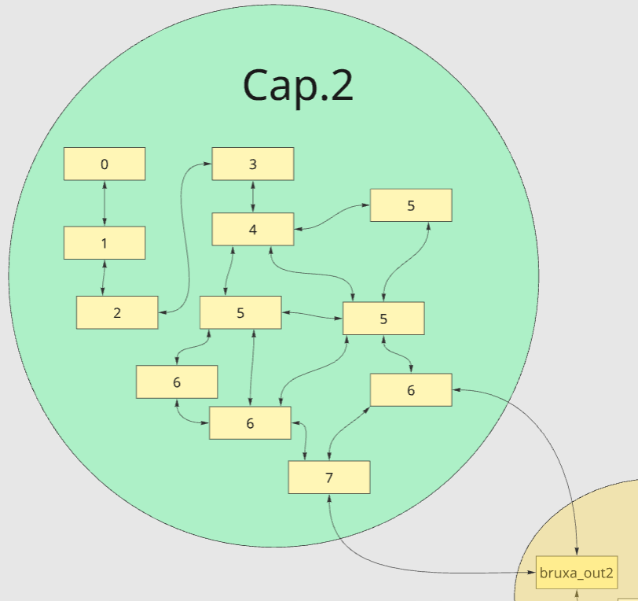

# Jogo da Bruxa





MAPA: https://miro.com/app/board/uXjVHHRQsyM=/

# Coisas a fazer

```
  ==============================
||		LEGENDA:	||
||	[ ] A fazer		||
||	[.] Em progresso	||
||	[?] Testar		||
||	[!] Finalizado		||
  ==============================
```

## Terminar até o Cap. 1 (1)

```

[ ] Arte Visual 100% 	(arquivos .png estão na pasta /assets/)

	[ ] Faces	(422x908 hoje, porém a parte de baixo fica escondida atrás da caixa de diálogo. pode mudar para 420x740 ou outro tamanho)
		[ ] Bruxa
			[ ] neutro
			[ ] pensando
		[ ] Rei
			[ ] neutro
			[ ] furioso
		[ ] Princesa
			[ ] neutro
		[ ] Guarda1
		[ ] Guarda2
		[ ] NPC1 - Criança
			[ ] neutro
		[ ] NPC2 - Criança
			[ ] neutro
		[ ] NPC3 - Adulto
			[ ] neutro
		[ ] Goblin
			[ ] neutro
		[ ] Padre
			[ ] neutro

	[ ] Sprites		(tamanhos variados) (a âncora do sprite é o CENTRO-INFERIOR) (pode mudar as larg/alt se quiser)
		[ ] Bruxa
			[ ] parada		(80x252)
			[ ] andando		(126x252)
			[ ] correndo	(126x252)
		[ ] Rei				(105x200)
		[ ] Princesa		(105x200)
		[ ] Guarda1			(105x200)
			[ ] parado
			[ ] andando
		[ ] Guarda2			(105x200)
			[ ] parado
			[ ] andando
		[ ] NPC1 - Criança	(105x145)
			[ ] parado
			[ ] andando
		[ ] NPC2 - Criança	(105x145)
			[ ] parado
			[ ] andando
		[ ] NPC3 - Adulto	(105x200)
			[ ] parado
		[ ] Mercador pai	(105x200)
			[ ] parado
		[ ] Mercador filho	(105x200)
			[ ] parado
		[ ] Padre			(105x200)
			[ ] parado
		[ ] Portas
			[ ] porta padrão (90x180)
			[ ] porta bruxa
			[ ] portão castelo
		[ ] Objetos
			[ ] Livro de Receitas (69x69)
			[ ] ...

	[ ] Cenários		(largura variada, altura: 640px)
		[ ] floresta		(6000x640)
		[ ] bruxa_in		(1280x640)
		[ ] bruxa_out1		(1280x640)
		[ ] bruxa_out2		(1280x640)
		[ ] bruxa_out3		(1280x640)
		[ ] bosque			(2000x640)
		[ ] cidade			(4000x640)
		[ ] cidade_in01		(1280x640)
		[ ] cidade_in02		(1280x640)
		[ ] cidade_in03		(2000x640)
		[ ] estrada_a		(2000x640)
		[ ] ponte			(2000x640)
		[ ] castelo			(3000x640)
		[ ] castelo_in01	(2500x640)
		[ ] castelo_in02	(1280x640)
		[ ] castelo_in03	(1280x640)
		[ ] estrada_b		(2000x640)
		[ ] Fundo menu inicial (640x960) (ou uma img em loop)

[ ]	Audio 100%
	[ ] BGM:
		[ ] intro 			(xxxHolic opening)
		[ ] floresta		(remix da que já tem)
		[ ] bruxa_out
			[ ] bruxa_out1	(só BGS de natureza)
			[ ] bruxa_out2	(só BGS de natureza) (variação)
			[ ] bruxa_out3	(só BGS de natureza) (variação2)
		[ ] bruxa_in 		(sem bgm, talvez bgs)
		[ ] bosque			(mágico, bem curto)
		[ ] cidade, _in01, _in02 (+ harpa, - volume, +palmas)
		[ ] cidade_in03
		[ ] estrada_a
		[ ] ponte
		[ ] castelo
		[ ] castelo_in01, castelo_in02
		[ ] castelo_in03
		[ ] estrada_b
		[ ] menu inicial
		[ ] ???
	[ ] BGS:
		[ ] sapos (bruxa_out1)
		[ ] tremor
		[ ] passaros
		[ ] som floresta
		[ ] vento
		[ ] água correndo
		[ ] (metal?)
	[ ] SE:
		[ ] magia01
		[ ] magia02 
		[ ] magia03
		[ ] pancada01
		[ ] pancada02
		[ ] corte
		[ ] vidro01
		[ ] vidro02


[ ] Caldeirão 100%
	[?] Roxo em dois: Violeta (roxo claro, fogo 1500, caldo 163-180 °C; id antigo "purpura") e Índigo (roxo escuro azulado, fogo 1700, caldo 180-195 °C), antes do Negro (2000). No livro são dois estados. Nenhuma receita usava o roxo; simulador sem mudança nas 3 receitas.
	[ ] Catálogo e poções
		[?] Catálogo de poções (dados/pocoes): 
			qualquer poção com a matriz perto de uma do catálogo recebe o nome dela e, se ela tiver, 
			o efeito (com aproveitamento >= aproveitamento_min_efeito; 
			evita 4 mal cozidos = 3 bem cozidos). 
			Sem quantidades nem "Dobrada" (não serve para receitas não comutativas).
			[?] Tolerância por poção (PocaoReferencia.distancia_max; 0 = a do catálogo, 0,05). 
				Retorno: 0,02 → 2 ou 4 pós bem cozidos não viram mais Poção do Retorno nem ganham o efeito 
				(simulador: experimento quantidade). 
			[ ] PROBLEMA a tratar: quantidades diferentes podem chegar na mesma matriz (ex.: 4 mal cozidos ≈ 3 bem cozidos). 
				Hoje só o aproveitamento mínimo segura. Já é o suficiente, mas tem algo mais geral?

[ ] Livro de Receitas:
	[?] Ao criar uma poção desconhecida ele pede para dar o nome. O nome vai para a receita e para a poção criada, e fica armazenada, se o jogador criar outra semelhante o nome já virá automaticamente.
		[?] Já funciona: sai como "Poção desconhecida" e o nome é dado no livro (ao passar o rascunho a limpo); vai para a receita, o item e o catálogo do jogador (salvo), e as próximas parecidas já vêm com o nome.
	[ ] Receitas:
		[?] Nome: poção de um item só agora usa "Poção de [item] [qualidade]" antes de procurar no catálogo (senão um pó mal cozido virava "Concentrada").
		[ ] Balanceamento de Receitas:
			[.] Criar mais receitas:
				Receita que é muito rápida , 
				receita que é muito demorada. 
				Receita muito quente, com fogo negro. 
				Receita muito fria, quase desligando. 
			[ ] Perguntas: 
				[ ] Dois pontos de cozimento diferentes para o mesmo item podem gerar poções diferentes? 
				[ ] Faz sentido uma receita que leva o mesmo ingrediente 2x em tempos diferentes? I_tempo, I_Temper, Q, como conseguir aprovetar duas vezes um mesmo tipo de item numa mesma receita?
				[ ] E se eu dobrar a poção? Testar com as não comutativas: Fazer receita dobrada tem efeito de potencializar (escalar) a matriz resultante. por exemplo se fizer uma poção da calma profunda dobrada, 
				[ ] dificuldade, medir peso de cada erro: tempo, temp, cozimento, 
				[ ] explorar os TIPOS de matrizes. explorar o que é posível nesse sistema térmico
		[.] Ver tipos de poções e dar nomes: 
			Database (nomes das proibidas ficam para o Cap. 2): 
				Nomear as poções de referência no catálogo (PocaoReferencia: nome, descrição, A). 
				Poção da Calma Profunda. Poção #2. Poções proíbidas. 
				Poção #2 = Poção da Desenvoltura (definir bem antes do Cap. 1; só usada no Cap. X).
				Poções proibidas: as que têm algum autovalor 0 (2^5 − 1 = 31 combinações de traços zerados). Ainda sem nome. (feito: 31 no catálogo como "Poção Proibida (sem O, C...)", nomes provisórios)

[ ] Diálogos 100%
	[ ] Cap. 1: Revisão de cada evento.
	[ ] Sprites do  Balão de expressão: precisa da arte (1 sprite de balão, se der pra fazer sem deformar as quinas seria ideal) (talvez 9 blocos)
		[?] Pronto para a arte: assets/ui/balao.png (um sprite com o rabicho embaixo no meio, desenhado em 2×). Cantos de 40 px não esticam; só o meio estica. Rabicho: faixa de 24 px de baixo. Deixei um provisório no lugar; sem o arquivo volta o desenhado em código. Ajustes em cmd_balao.gd (MARGEM_SPRITE, RABO_SPRITE, ESCALA_SPRITE).
	[ ] Estilo visual:
		[ ] organizar o layout e textura dialogo/opções
		[ ]	Ajuste estético, borda, cor, fonte, etc.
	[?] Só aparece a setinha pra baixo para avançar diálogo quando a frase terminar. antes disso o botão o botão pode ser apertado mas o simbolo para baixo não pode ter.
		[?] Feito: a ▼ some enquanto o texto está sendo escrito e aparece (0,2 s) quando a frase termina. O toque continua funcionando antes (completa a frase).


[ ] História/Roteiro
	>>>	Diálogos devem condizer com a época
	
	[ ] Revisar diálogos dos eventos/cenas:
		[.] Cap. 1 (-N)
			[?] intro-Campones
			[?] Guardas
			[ ] Bosque NPC
			[?] Cidade
				[ ] Casa 1, não tem nada. 
			[?] Castelo
				[ ] Casamento
				[ ] Fuga
					[ ] Com Retorno
					[ ] Sem Retorno
				[ ] Esperar
					[ ] Abriu porta -> Fuga
					>>> Enrolar -> dia nunca passa
				 
		[ ] Cap. 2
			[ ] Qual traço? 
			[ ] Qual quest?
	>>> Usar traços na história: 
		O,(conservador com pouca abertura)
		C (consequencialidade, prudencia, preguiçoso),
		A (amabilidade, aumentar ou diminuir?)
	[ ] Usar permutação de traços em alguma quest, receita, mas que seja visto esse efeito.
	[ ] Poções proibidas numa quest


[ ] Quests (tirar?)
	[ ] Quest Zigmund
		[ ] personalidade
		[ ] situação
			[ ] problema
			[ ] objetivo
			[ ] plano
			[!] sumiu na floresta
			[!] pediu para a bruxa ajudar a princesa
			[!] casamento
	[ ] Quest Bosque Goblin
		[ ] (ainda não tem nada fixo, mas pode ser um ser mágico que vive no bosque)

	[.] Mercador
		[ ] Inventário de cada, personalidade de cada?
		[ ] Comprar e Vender? 
			[ ] 2 inventários e você pode trocar/negociar?


[ ] Personagens
	[ ] Fazer uma ficha de personagem 
	[ ] Criar personalidades big five
	[ ] Cada personagem tem seu linguajar próprio e manias.
		[ ] Bruxa
		[ ] Campones N+ C-
		[ ] Guarda1 C- A+
		[ ] Guarda2 C+
		[ ] bosque_npc
		[ ] Cidade
			[ ] NPC Adulto O- 
			[ ] NPC Criança 1 O++ 
			[ ] NPC Criança 2 O++ A+
			[ ] Casa 1
				[ ] NPC 
			[ ] Casa 2
				[ ] Mercador Pai A+
				[ ] Mercador Filho E--
			[ ] Igreja
				[ ] Padre O- C++ A+
		[ ] Castelo
			[ ] Rei O- C- A+
			[ ] Princesa N++ A+ O+

[ ] Documentação e Organização
	[ ] organização da pasta Graphics(está sendo chamada de assets neste projeto) estilo rpgmaker:
		Animations (efeitos especiais, magias, etc)
		Characters (eventos)
		Icons
		Panoramas (imagens para cenário)
		Pictures (sprites para controlar na tela)
		Transitions
		Windowskins (janelas, etc)
	[ ] Debug e ferramentas
		[.] Debug, aba Poções: histograma do aproveitamento de cada poção feita (user://estatisticas_pocoes.txt; só em build de debug), zerar, e botões para dar qualquer poção do catálogo pronta (★ = tem efeito).
			[.] Colocar botão poara limpar o histórico.
	

[ ] Aplicar poção:
	[.] A ação da poção deve mostrar a personalidade mudando.
		Ideia: um pequeno menu com a face da pessoa e a personalidade dela mudando; a personalidade fica na carta Status. Layout ainda a definir.
		[?] Feito (1ª versão): MenuAplicarPocao (src/ui/menu_aplicar_pocao.gd). Abre junto com o inventário no "Aplicar poção": nome e face do alvo (dados/falantes/<personalidade>.tres, ou o campo "personagem" do comando) e o pentagrama O C E A N com a personalidade dele (só a forma, −10 a 10). Tocar numa poção mostra a prévia tracejada; aplicar anima a forma e mostra setinhas ↑↓ por um instante; depois fecha. Fica sobre a carta Status, com a face e o nome numa carta logo acima (os outros jeitos e a tecla M saíram).
		[?] Destaque ao aplicar: o popup fecha, 0,5 s depois a carta dá um clarão dourado, a face brilha, cresce e treme com faíscas, e o pentagrama muda devagar (com um pequeno "passa e volta"), as pontas que mudaram pulsam e as setinhas ↑↓ ficam maiores e pulando. O efeito mágico no alvo acontece junto. O menu fica mais 1,2 s e fecha.
		[?] Escala da mudança: agora o pentagrama usa o valor real (−10 a 10) na prévia e ao aplicar, sem raiz. Mudanças pequenas ficam quase imperceptíveis. Contorno cinza = como estava.
		[ ] Adicionar tecla para trocar o layout do aplicação de poção. quero uma opção em que a personalidade da pessoa apareça aonde está o status da bruxa, e a foto apareça numa carta acima do status.
			[?] Feito: ficou só este jeito (os outros e a tecla M saíram); o pentagrama do alvo fica exatamente no lugar da carta Status da bruxa e a face com o nome numa carta logo acima dela (mesma largura).
	[ ] Representação de poções visual com matriz/grafo. (feito, versão simples: no pentágono cada ponta sai do traço que mais contribui e gira até a sua; diagonal = só escala com um pulo)
		[ ] (Cap. 2) Mostrar o pentagrama, cada aresta representa um componente. Pensei em relacionar as arestas com a_ij e criar um feedback útil visualmente.
		[ ] (Cap. 2) O pentagrama deve ter animações a depender da matriz. Por exemplo, matriz diagonal (ou próxima de diagonal a menos de ruído) só escala, então a animação do pentagram é escalar. Matriz que troca dois componentes deve trocar duas pontas do pentagrama suavemente, como uma permutação ou rotação.

```

## Ideias guardadas: traços e próximas poções

```
Ideia geral: o jeito de cozinhar o ingrediente imita o traço que ele mexe.
Matriz: O C E A N. "×1,12" = o traço sobe 12%. "E ← +0,08·N" = 8% do N passa a somar no E.

C (disciplina, ordem, dever)
	Pouco C querendo subir: filho do mercador, guarda que dorme, Zigmund que largou as obrigações.
		Poção da Disciplina (C ×1,2). Ingredientes demorados e de faixa estreita (paciência e precisão).
	Muito C querendo baixar: noivo perfeccionista que adia o casamento, padre preso às regras.
		Poção do Desapego (C ×0,8). Ingredientes rápidos e de fogo forte (impulso).
	Troca: C ← N (a ansiedade vira cuidado).
A (confiança, gentileza, cooperação)
	Subir: rei furioso, guarda grosso, goblin. Poção da Brandura (A ×1,15). Ingredientes frios e delicados.
	Baixar: quem não sabe dizer não (princesa? mercador que dá fiado). Poção da Firmeza (A ×0,85). Chama negra.
	Dilema: baixar a amabilidade de alguém é ajudar ou estragar? ("tudo tem seu preço")
O (curiosidade, imaginação, aceitar o novo; o traço mais ligado ao véu e à inquisição)
	Pouco O (velho cabeça fechada): mercador pai, padre. Poção da Visão (O ×1,2): enxerga o véu ou aceita o
		diferente; em 1484, aberto demais vira suspeito de heresia. Ingredientes estranhos, com troca de
		traços; receitas fora do padrão (chama fria e depois quente, mesmo item em dois tempos).
	Baixar O: quem viu demais através do véu, criança que vê fantasmas, ou a inquisição pedindo para
		"curar" a magia. Poção do Esquecimento (O ×0,8). Ingredientes comuns, cozimento longo e monótono.
N e E (o outro lado)
	Subir N: poção de medo (afastar a inquisição, guarda nervoso larga o posto). Primeira poção "ofensiva".
	Baixar E: bobo da corte, alguém que fala demais da bruxa. Poção do silêncio.
Matriz: diagonal pura = poções simples (começo); com troca = avançadas (transformam um traço em outro);
	proibidas (traço vai a zero) = o que a inquisição acha que a bruxa faz.
Sequência possível: Cap. 2 C alto (Zigmund/guarda) e A alto (rei); Cap. 3 O alto (mercador pai/padre,
	risco de heresia); depois A baixo, O baixo, N alto, E baixo, com escolhas morais.

Itens possíveis (receitas: rápida, demorada de faixa estreita, chama negra, fria)
	Rápida (fogo forte, poucos segundos):
		Pimenta-de-dragão: E ×1,12, A ×0,97, N ×1,05 (agitação, ousadia). Branco, 4 a 8 s.
		Faísca-de-vagalume: O ×1,10, C ×0,95 (curiosidade, impulso). Amarelo ou branco, 3 a 6 s.
		Pétala-de-relâmpago: E ← +0,08·N, N ×0,92 (nervosismo vira energia). Branco, 5 a 9 s.
	Demorada (faixa estreita, não dá para acelerar com fogo alto):
		Raiz-de-teixo: C ×1,15, O ×0,95 (prudência, tradição). Só normal (95 a 105 °C), 100 a 160 s.
		Casca-de-carvalho-velho: A ×1,12, N ×0,90 (paciência, serenidade). Só laranja, 90 a 140 s.
		Âmbar-de-resina: C ← +0,06·N, N ×0,94 (ansiedade vira cuidado). Só normal, 120 a 180 s.
	Muito quente (chama negra, 195 °C ou mais; precisa F perto de 1730, testar se não cansa):
		Escama-de-salamandra: E ×1,20, A ×0,90 (coragem, menos gentileza). 10 a 25 s.
		Carvão-de-sabá: O ×1,15, A ×0,85, N ×1,10 (rebeldia, inquietação). 15 a 30 s.
		Pena-de-fênix: E ×0,90, N ×0,90, E ← +0,10·N, N ← +0,10·E (troca parte do E com o N). 8 a 20 s.
	Muito fria (transparente, estraga acima de ~78 °C):
		Orvalho-da-lua: N ×0,85, E ×0,95 (calma, recolhimento). 30 a 60 s.
		Flor-de-gelo: A ×1,10, O ×0,95 (doçura, conformidade). 25 a 50 s.
		Lágrima-de-fantasma: O ×1,12, N ×1,05 (sensibilidade ao véu). 40 a 70 s.

NPC do bosque: o goblin (ideia, ainda não feito)
	Vigia os cogumelos brilhantes. A baixo (grosso, cobra pedágio), N alto (desconfiado de tudo).
	Cap. 1: só sabor e uma dica, sem quest. Cap. 2: alvo natural da Poção da Brandura (subir A).
	1ª vez:
		GOBLIN: Pare aí! Esses cogumelos têm dono.
		BRUXA: E quem seria o dono?
		GOBLIN: Eu. Quem passa, paga. Um cogumelo por cabeça... e você tem cabeça grande, com esse chapéu.
		BRUXA: Não vim colher nada. Só estou de passagem para a cidade.
		GOBLIN: Todos dizem isso. Depois some a metade do bosque.
		GOBLIN: Lá na cidade andam falando de mulheres de chapéu. Os homens do Papa estão perguntando por elas.
		BRUXA: (Hmm... então a notícia já chegou aqui.)
	Depois:
		GOBLIN: Você de novo. Não toque em nada.
		GOBLIN: Se for ao castelo, olhe para o alto da torre. A névoa de lá não é névoa.

Receitas para os extremos que faltam (ideias; testar no simulador antes)
	Raiz-de-teixo (demorada): C ×1,15, O ×0,95. Só chama normal (95 a 105 °C), 100 a 160 s.
		Poção da Disciplina (C ×1,2): chama normal, 2 raízes por 120 s. Para Zigmund / guarda que dorme.
	Faísca-de-vagalume (rápida): O ×1,10, C ×0,95. Chama branca (145 a 163 °C), 3 a 6 s.
		Poção da Visão (O ×1,2): chama branca, 3 faíscas em sequência, finalizar logo. Liga com o véu e a heresia (Cap. 3).
	Escama-de-salamandra (chama negra): E ×1,20, A ×0,90. Só chama negra (195 °C ou mais), 10 a 25 s.
		Poção da Coragem: chama negra, 2 escamas; fecha com 1 olho de salamandra para amaciar (mesma criatura, outra parte).
	Orvalho-da-lua (fria): N ×0,85, E ×0,95. Estraga acima de 85 °C, 30 a 60 s (usa transparente e pêssego).
		Poção do Recolhimento: transparente, 2 orvalhos; sobe para pêssego e 1 musgo-do-recato no fim.
	Onde achar: raiz na floresta; faísca no bosque (perto do goblin); escama com o mercador; orvalho raro no bruxa_out.
	Testar: se a chama negra cansa (F perto do máximo) e se a faixa estreita da raiz é jogável no celular.
```

## Possíveis expansões (futuras)

```
[ ] Sistema de clima
[ ]	Sistema de fama
[ ]	Sistema de compra/venda
[ ]	Sistema de mercado/valor dinâmico

```
