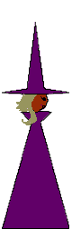
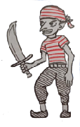

# Jogo da Bruxa

<table>
<tr><td>Engine</td><td>Godot 4</td></tr>
<tr><td>Plataforma</td><td>Android</td></tr>
<tr><td>Resolução</td><td>640 × 960 px</td></tr>
<tr><td>Gênero</td><td>Point & Click</td></tr>
<tr><td>Estilo</td><td>2D Side-scroller</td></tr>
<tr><td>Gameplay</td><td>Exploração + Crafting</td></tr>
<tr><td>Idioma</td><td>Português</td></tr>
</table>

```
Floresta    -   BruxaOut    -   BruxaIn
Bosque
Bosque
CidadeA     -   in01    -   in02    -   in03
EstradaA
Ponte
Castelo     -   in
EstradaB
```



## Coisas a fazer

```
  ==============================
||		LEGENDA:	||
||	[ ] A fazer		||
||	[.] Em progresso	||
||	[?] Conferir		||
||	[!] Finalizado		||
  ==============================
```

## Terminar logo (0)

```


[.] v3
[?]	balancear itens e preparo.
		Erva + cogumelo (1ª receita): erva m5200 s2000/3000 Tmin50 k.3 Tmax135 k.15 (queima ~140+) t25–90 h.4; cogumelo m1200 s600/900 Tmin100 k.15 Tmax160 k.15 t5–25 h.4/.5. Fogo: K 0.3, CONST_A 30.
		Receita ideal (~60 s): acende → erva com água morna (~8 s) → cozinha até ~40 s → ~1 clique/s até chama BRANCA (~120 °C) → cogumelo (~48–50 s) → frita ~10 s → termina. Perfeito → Poção da Calma Profunda (só N cai, 0,93).
		2ª receita (E): Flor-de-farra (E +20%, mas C −5%, A −6% e N +5% de E) em INFUSÃO 75–95 °C (ferver estraga), m2400 (~30 s a 85 °C), t 20–70 s.
		  Musgo-do-recato (compensa C, A e N) entra POR ÚLTIMO: sem cozimento, t 2–12 s. → Poção da Desenvoltura: só E +20%.
	[ ]		Balancear depo'is: Calma Profunda (talvez ~4 cogumelos + 4 ervas) para baixar bem o N numa poção só; rever o critério N < 4 (8 → 4 é muito). Agora coloquei 8 ervas e 8 cogu, 
				Aí diminui mais ainda a % de N, deve ser perto de 50%. Tem que balancear tudo junto. Mas confirmo que serão 8 e 8. O teste de personalidade deve

[] diálogo:
	[.]	Castelo_in: pausa, camera no Rei, fala "pode vir aqui" ou algo assim. Então os guardas acompanham a bruxa até ele. Pausa. Os guardas recuam. Pausa. Aí começa o diálogo com o rei. Em certo momento da fala, a princesa diz que a bruxa é a única que pode ajudar. (feito: guardas castelo_in_guarda1/2 em x 330/260; câmera vai até o rei (848, 505); "Venha até aqui."; guardas vão até x 600/540 com a bruxa (700) e voltam; princesa: "Ela é a única que pode me ajudar.")
			Finalizar correção de movimento dos guardas.
[] mapa:
	[] bruxa_out, mais camadas (v3)
	[] castelo_in, aumentar corredor (v3)
	[] ponte, nuvens e parallax (v3)
[.] Preparo:
	[.] a escala de fogo deve ser azul(máximo) próximo dos 2000. o vermelho também pode subir um pouco a escala. (CORES_FOGO: vermelho 650, laranja 950, amarelo 1050, branco 1150 ≈ 136 °C, azul claro 1450, azul 2000)
	[.]		Layout: Anotar o tempo e temperatura no momento que cada item entrou nos itens. quero não só número, mas uma representação visual útil. estava sobrepondo a área do ingrediente. vamos fazer testes visuais
			Teste 1: cada ingrediente tem um número (ordem de entrada) numa bolinha na cor da chama de quando entrou; a mesma bolinha numerada aparece na curva principal, no ponto de entrada. Nome na lista: "1. Erva".
	[.]		Nomear as poções de referência no catálogo (PocaoReferencia: nome, descrição, A). Poção da Calma Profunda. Poção #2. Poções proíbidas. 


	[ ] História / missão: (em ordem)
		[.]		A bruxa diz quais & qtos itens tem que pegar e libera controle na primeira missão. (8 cogumelos e 8 ervas) (falas atualizadas: "Oito cogumelos... E oito ervas..."; Calma Profunda no catálogo agora diag(1,1,1,1,0,5625) = 8 cogumelos; princesa N 8 → 4,5)
		[.]		finalização, entrega poção e resultados possíveis.
		[ ]		ajustar personalidade da Princesa (dados/personalidades/princesa.tres): O5 C(-2) E4 A6 N8. (princesa.tres atualizado)
				missao1_resultado: 
					0 não entregou: · 
					1 bom (N < 4 e outros traços mudaram ≤ 2) · 
					2 calma, mas mudou outros traços > 2 · 
					3 pouco efeito (4 ≤ N ≤ 8) · 
					4 piorou (N > 8). 
					Isso não será assim. Esse seria um teste para ver se N foi bem feito. Teoricamente são 25 combinações entre 5 possibilidades (aumentou muito, aumentou pouco, neutro, diminuiu muito diminuiu pouco) para cada uma dos 5 traços.
					Também temos que fazer testes pois a depender da poção pode zerar um traço deixando a pessoa estereotipada.
					CmdMedirMudanca guarda em missao01_desvio a maior mudança em O, C, E, A. (não será assim, talvez o evento tenha que ter várias páginas com condições a partir de como está sua personalidade respectiva.)(pode remover esse comando: o castelo agora usa CmdClassificarPersonalidade; apague src/dados/comandos/cmd_medir_mudanca.gd)
					Daí Reações diferentes da princesa/rei para cada resultado (hoje só "Eu... me sinto diferente." e "Veremos no casamento.").
					Feito (base): CmdClassificarPersonalidade compara com princesa.tres e grava missao01_O/C/E/A/N (−2 diminuiu muito, −1 pouco, 0 neutro, +1, +2; r = Δ / max(|ref|, 1): < 0,1 neutro, < 0,4 pouco) e missao01_extremo (traços ≈ 0 ou |v| ≥ 9,5).
					missao1_resultado hoje: 1 N −2 e nenhum outro ±2 · 2 N −2 mas outro traço ±2 · 3 pouco efeito · 4 N subiu · 5 estereotipada (algum traço extremo). Rascunho das reações feito (castelo_in_auto / rei / princesa): uma fala da princesa e do rei para cada resultado 1–5, e o rei e a princesa têm uma fala própria por resultado depois da entrega. Revisar o texto.
					1 bom: princesa "já me sinto mais calma"; o rei aceita a contragosto e começa a resmungar; a princesa interrompe, agradece, já pensa no vestido e convida a bruxa para o casamento; o rei aceita (missao01_convite = 1).
					5 estereotipada: a princesa repete "Casamento. Vestido." e o drama cresce; o rei manda prender a bruxa, ela pede desculpas, não adianta; ela foge por outros cômodos do castelo, chega ao véu, pega um pedaço (missao01_veu = 1) e usa um FEITIÇO de volta para casa (não é o véu que teleporta). Os guardas entram e não tem ninguém. Ela aparece em bruxa_in.
						Provisório: a fuga é em tela preta, só com os pensamentos da bruxa, até existirem os outros cômodos (castelo_in1, in2...).
		[ ]		Roteiro: antes dessa cena, mostrar que a bruxa conhece um feitiço (ou tem um item) que leva de volta para casa, SÓ para casa. Senão fica do nada.
				Acesso ao castelo é livre (sem variável). Só o resultado 5 (fuga) cria problema. Nos outros casos o véu continua lá: ela entra por algum cômodo do castelo e vai buscar (castelo_in1, in2... a criar).
					A parte 2 da fuga (troca de cenas pelos cômodos) fica para depois.
				Depois: com resultado 5, o rei manda prender se ela voltar ao castelo (só fala, ainda não prende de verdade).
```

## Terminar até o Cap. 1 (1)

```

[ ] BETA / DEMO:
[ ]		Caldeirão 100%
[ ]		Diálogos 100%
[ ]		Sprites 100%
[ ]		Audio 100%
[ ]		Menus 100%


[ ] Bugs/Revisão:
[?]		CmdMoverPlayer liberava o evento antes do movimento começar (diálogo aparecia com a bruxa andando). Agora espera começar (até 0,5 s) e depois terminar.
[?]		Camera trava quando chega num canto de tela mas o parallax não deve travar, senão dá uma sensação ruim de impacto quando chega perto de um canto de tela.
			Feito: camera_2d.gd lê limit_left/right e usa borda suave (BORDA_SUAVE 200 px, aproximação exponencial). Vale para todos os mapas.
			CamadaParallax (src/cena/camada_parallax.gd, Parallax2D): textura, fator (0 céu parado, 1 mapa, >1 frente), loop_x, pan (px/s), deslocamento. Ponte: nuvens (Fundo3) conicavertidas. Converter as outras camadas/mapas aos poucos.
[?]		Página com várias condições (todas precisam valer): variável, item, personalidade, posição, direção
[?]		Página reavalia ao ganhar/perder item e ao mudar personalidade
[?]		Notificação de item nunca aparece (NotificacaoItem sem Label em main.tscn)
			Label já existe; agora o painel começa escondido e uma notificação nova não é mais apagada pelo timer da anterior.
[?]		Segurar o botão de poção para sair agora é 0,7 s (TEMPO_LONGO)
[ ]		Tutorial do caldeirão na 1ª vez.
[ ]		Um card depois do outro se ativer os 2. (primeiro inventário depois status). se ativar só um, só aparece ele.
[ ]		Fazer faces tbm terem seu .tres

[ ]	Representação de poções visual com matriz/grafo.
[ ]		Mostrar o pentagrama, cada aresta representa um componente. Pensei em relacionar as arestas com a_ij e criar um feedback útil visualmente.
[ ] 	Na hora da aplicar a poção, inventário, resultado do preparo, sempre mostra o pentagrama e a matriz.
[ ]		O pentagrama deve ter animações a depender da matriz. Por exemplo, matriz diagonal (ou próxima de diagonal a menos de ruído) só escala, então a animação do pentagram é escalar. Matriz que troca dois componentes deve trocar duas pontas do pentagrama suavemente, como uma permutação ou rotação.


[ ]	Escrita/Estilo:
[ ]		Diálogos devem condizer com a época
[ ]		Cada personagem tem seu linguajar próprio e manias.

[ ]	Cena Livro de Receitas: (DEPOIS DO CAP. 1)
[ ]		Ao criar uma poção nova a bruxa tem opção de anotar a receita no livro. Caso escolha anotar: Abre a cena do livro de receitas já anotando.
[ ]		Iniciar o livro de receitas, cena com janela que inicia após uma nova receita. A cena de livro abre e é escrita uma nova receita.
[ ]		Pensar no Layout
[ ]		Uma receita por página, 2 páginas por folha, mostra o livro aberto e tem opção de controlar com clique ou arrastando, é redundante para melhor UX.
[ ]		Ao clicar numa página mostra seus ingredientes e tempo relacionado com seu gráfico, seu resultado.
[ ]		Fazer tudo bem animado e temático de bruxaria.


[.] Itens:
[?]		Matriz A aceita poucas casas decimais no Inspector, ainda está arredondando para 2 casas. quero no mínimo 5. Por enquanto tenho que editar diretamente o .tras
				Passo do Inspector agora é 0.00001 (item_data.gd). Conferir no editor.


[?] Intro: (Cap. 1)
[x]		Melhorar texto: reduzir? etc... (5 legendas curtas, CmdLegenda)
[x]		Melhorar representação do texto subindo. (intro_fundo sobe; toque pula a intro: CmdPularComToque)

[.] Interprete:
[?]	    comando if para verificar, além de variaveis; itens ou personalidade (GameTemp)
				Feito: Condicao.tipo = variável, item, personalidade, posição X/Y da bruxa, direção da bruxa (vale p/ if, while e páginas)
[?]     comando mudar direção player (CmdDirecaoPlayer: esq, dir, inverter, para evento)
[?]	    comando mover player (CmdMoverPlayer: para X, para evento, deslocar; esperar; direção final)
[?]     comando deixar evento passavel ou ativar/desativar colisão do player (CmdEventoPassavel)
[?]			colisão do player: CmdPlayerPassavel
[?]     comando mudar direção evento (CmdDirecaoEvento: centro, esq, dir, inverter, para o player; diferente de trocar animação)


[ ]	Caldeirão:
[x]		Ajustes mínimos: cor, shake, efeitos, aparar para a versão final. (vapor acima de 100 °C, baforada de fumaça ao abafar)
[?]		Labaredas (faíscas laranja subindo) ao abanar o fogo.
[ ]		Tutorial(leve) na primeira vez. (DEPOIS DO CAP. 1)

[ ] Mapa:
[?]	Só 1 cogumelo no bosque a cada 10seg. na estradaA tem 5 cogumelos com delay de 2seg.
[?]     Spawn de itens: existem as áreas de spawn, que invocam um tipo de evento, limitados por qtd de invocações no mapa.  
[.]         Remover todos eventos placeholders de item dos mapas
				Removidos os 6 cogumelos de teste (teste_magia) de bruxa_out e castelo_out. Fica só o da história (estradaA). teste_magia.tres sem uso.
[?]         Adicionar o floresta_erva oficial (AreaErva na floresta)
[?]         Adicionar o bosque_cogumelo oficial (AreaCogumelo no bosque, x≈1000–1700, y=580: ajustar no editor)
[.]     Resolver problema de área de colisão, verificar cada evento, posição, etc.
[?]		Quando chego perto de uma borda o paralax age parando bruscamente, quero que ele não fique limitado à tela, talvez tenho que mudar o tamanho dos cenários? (câmera com borda suave; CamadaParallax na ponte)
[.]		Padronizar parallaxes em cada mapa: ...,Fundo2,Fundo,Meio,Frente,Frente2... (meio é onde ficam os eventos também)
[?]		Testar loop de bgm, loop de bgs. (floresta.mp3 já está com loop=true no import)
[?]		cada mapa tocando BGM da fase em loop. (verificar mapa_base)
			Feito: mapa_base tem bgm/bgm_volume no Inspector. Mesmo bgm = continua; outro = troca; vazio = para. Só a floresta tem bgm (floresta.mp3).
[ ]		SE nos teleport (depois: som de passos na transição)
[?]		Tela preta das passagens mais curta: "esperar" depois do teleporte baixado de 0.4 para 0.2
[ ]	Verificar todos os parallaxes (valores, direção, bordas).

[.]	HUD/inventário:
		Feito (1ª versão): src/ui/carta.gd + hud.tscn refeito. Duas cartas: CartaInventario (Verso/Inventario/Dialogo) e CartaStatus (Verso/Status/Opcoes).
		Toque no verso abre; 4 s sem tocar na carta (nem popup do item aberto) desvira. Independentes. Fechada ocupa o mesmo espaço.
		Diálogo/opções: DialogBox e OptionBox vão para dentro das cartas (face de prioridade); a carta vira sozinha e volta para onde estava.
		mostrar_hud/sumir_hud: ativa/desativa as cartas (inativas somem, mas aparecem no diálogo).
		Virada na diagonal (angulo_diagonal 45°), sem pulinho. Conteúdo vai para um Node2D "Giro" no _ready: use carta.face("Nome").
		Margem só no conteúdo (MARGEM_CONTEUDO = 20, hud.gd); botões de opção ocupam a carta toda e são pretos.
		Foto e nome do falante ficam fora da carta (CanvasLayer): não giram, fade só quando mudam.
		Ajustar: tempo_aberta, tempo_virar, angulo_diagonal (Inspector da carta).
		Verso provisório: pentagrama desenhado (src/ui/pentagrama_verso.gd, gira devagar; cor/espessura/raio/giro no Inspector). Trocar pela arte quando existir.
[?]     Separar o Inventário do HUD. O HUD deve fazer o esquema de carta que vira ao clicar em um de seus componentes (inventário ou status), pensar como vai ser a dinâmica da carta girando, ativação, desativação, etc. Um clique em cima para mostrar, e se ficar alguns segundos sem interação ele desvira.
[?]		Animar o inventário e o status como um card que gira/abre ou algo assim. 
[?]		Fazer uma animação de carta virando para os diálogos, opções, inventário e status. 
[?]		Diminuir o botão de avançar diálogo em todas as laterais, pouca coisa.
[?]		Mostrar o pentagrama por cima dos Cards, talvez é problema de zindex.
[?]		No diálogo a tela deve escurecer um pouco mais.
[?]		No avançar diálogo o cursor triangular deve ficar com movimento y=sin((2pi/L)*x)


[ ]	Arte Visual
[?]     como fazer imagem ficar fazendo pan infinito? usar nas núvens
			Feito: src/cena/nuvens_movendo.gd num TextureRect em modo Tile (velocidade px/s). Aplicado nas nuvens da ponte (Fundo3).
[ ]     Fazer sprite:
[ ]         mapa floresta de 6000px (talvez diminua), com paralax, provisório.
[ ]         inventário e status de costas (card que gira)


[ ] Audio:
[ ]     Fazer músicas: 
[ ]         intro, 
[ ]         casa bruxa, 
[?]         floresta, 
[ ]         estradas, 
[ ]			ponte (ouvir ost: ragnarok, pokemon, nobuo uematsu)
[ ]         castelo, 
[ ]         ...
[ ]	Fazer sons:
[ ]		Teleport entre mapas
[ ]		Flip card
[ ]		Efeitos (...)

[ ]	Animações:
[ ]


[ ] Estilo:
[ ] 	organizar o layout e textura dialogo/opções
[ ]		Ajuste estético, borda, cor, fonte, etc.
[ ]		Criação de estilos padronizados para cada coisa. (?) tipo estilo texto, estilo menu, ...?
[ ]


[ ]	Estudar se vale:
[ ]		- Definir posição dos eventos no mapa, tudo por código


[ ]	Status: ()
[?]		popup do nome da característica quando hover ou click. ou algo legal. (status.gd: toque no ícone → balão com nome e valor por 1,5 s)
[?]		Animação de aparição. (como se virasse uma carta, etc)  (o status já vira como carta)


[ ]	Menu Principal e Pausa (DEPOIS DO CAP. 1)
[ ]	Save/Load (DEPOIS: muita coisa ainda pode mudar)
[ ]		Game_Temp deve ter save e load de arquivo_unico de titulo "save"+time_stamp
[ ]		GameTemp, posição player, mapa
[?]	Animações do player e eventos melhor organizada e testes.

[ ]	Core:
[ ]		Modularizar evento_base (ainda precisa?)
[ ]   Melhorias estruturais no sistema.
```

## Terminar até o Cap. 2 (2)

```
[ ] Sistema de clima
[ ]	Sistema de mercado/valor dinâmico
[ ]	Sistema de fama
[ ]	Sistema de compra/venda
```
