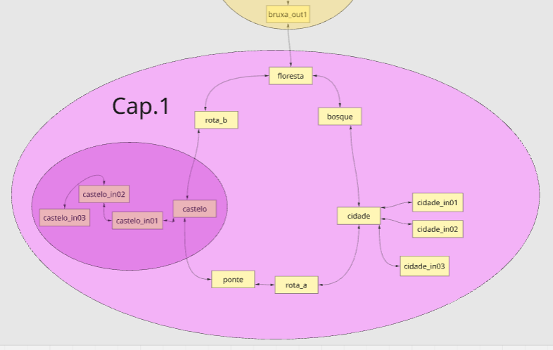
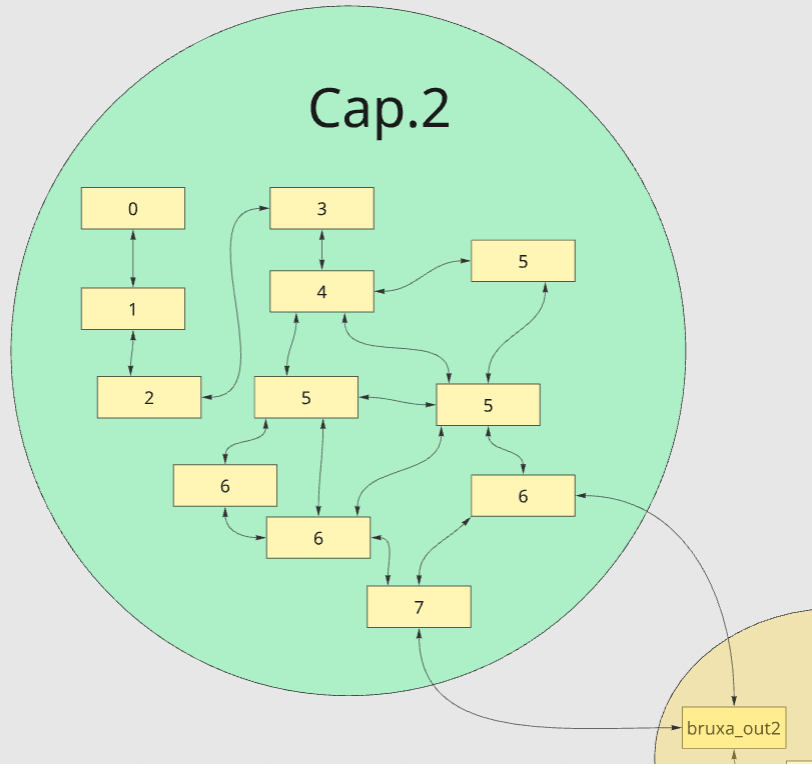
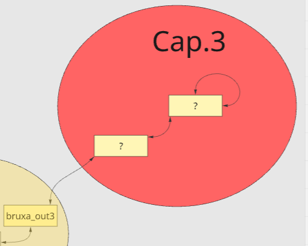

# Jogo da Bruxa







MAPA: https://miro.com/app/board/uXjVHHRQsyM=/

# Coisas a fazer

```
  ==============================
||		LEGENDA:	||
||	[ ] A fazer		||
||	[.] Em progresso	||
||	[?] Testar		||
||	[!] Finalizado		||
  ==============================
```

## Terminar até o Cap. 1 (1)

```

[ ] Sprites 100%
	[ ] Faces 			(422 x 908 ou algo assim)
		[ ] Bruxa
			[ ] neutro
			[ ] pensando
		[ ] Rei
			[ ] neutro
			[ ] furioso
		[ ] Princesa
			[ ] neutro
		[ ] Guarda1
		[ ] Guarda2
		[ ] NPC1 - Criança
			[ ] neutro
		[ ] NPC2 - Criança
			[ ] neutro
		[ ] NPC3 - Adulto
			[ ] neutro
		[ ] Goblin
			[ ] neutro
		[ ] Padre
			[ ] neutro

	[ ] Sprites			(tamanhos variados, abrir no assets)
		[ ] Bruxa
			[ ] parada
			[ ] andando
		[ ] Rei
		[ ] Princesa
		[ ] Guarda1
			[ ] parado
			[ ] andando
		[ ] Guarda2
			[ ] parado
			[ ] andando
		[ ] NPC1 - Criança
			[ ] parado
			[ ] andando
		[ ] NPC2 - Criança
			[ ] parado
			[ ] andando
		[ ] NPC3 - Adulto
			[ ] parado
		[ ] Mercador pai
			[ ] parado
		[ ] Mercador filho
			[ ] parado
		[ ] Padre
			[ ] parado
		[ ] Portas
			[ ] porta padrão
			[ ] porta bruxa
			[ ] portão castelo
		[ ] Objetos
			[ ] Livro de Receitas
			[ ] ...

	[ ] Cenários			(largura variada, altura:640px)
		[ ] floresta
		[ ] bruxa_in
		[ ] bruxa_out1
		[ ] bruxa_out2
		[ ] bruxa_out3
		[ ] bosque
		[ ] cidade
		[ ] cidade_in01
		[ ] cidade_in02
		[ ] cidade_in03 (será aumentado)
		[ ] estrada_a
		[ ] ponte
		[ ] castelo
		[ ] castelo_in01 (será aumentado)
		[ ] castelo_in02
		[ ] castelo_in03
		[ ] estrada_b

[ ]	Audio 100%
	[ ] O Áudio deve poder sofrer mudanças de pitch entre -1 e 1 (-12 e 12 semitons). isso pesa na reprodução do áudio?
	[ ] BGM:
		[ ] intro 	(xxxHolic opening)
		[ ] floresta	(revisar a que já tem)
		[ ] bruxa_out
			[ ] bruxa_out1	(sem audio, vai ter só BGS de natureza)
			[ ] bruxa_out2	(sem audio, vai ter só BGS de natureza) (variação)
			[ ] bruxa_out3	(sem audio, vai ter só BGS de natureza) (variação)
		[ ] bruxa_in
		[ ] bosque
		[ ] cidade, cidade_in01, cidade_in02 (+ harpa, - volume, +palmas)
		[ ] cidade_in03
		[ ] estrada_a
		[ ] ponte
		[ ] castelo
		[ ] castelo_in01, castelo_in02
		[ ] castelo_in03
		[ ] estrada_b
	[ ] BGS:
		[ ] tremor
		[ ] passaros
		[ ] som floresta
		[ ] vento
		[ ] água correndo
		[ ] (metal?)
	[ ] SE:
		[!] porta01 	(abrindo)
		[!] porta02 	(fechando)
		[!] passos 		(para transição)
		[!] pulo 		(velocidade)
		[ ] dash
		[ ] magia01		
		[ ] magia02 
		[ ] magia03
		[ ] pancada01
		[ ] pancada02
		[ ] corte
		[ ] vidro01
		[ ] vidro02
		[!] livro		
		[!] carta 		(girando)
		[!] aplausos
		[!] swing
		
[ ]	Menus 100%
	[ ] Estilo de cartas
		[ ] definir carta para cada clicável.
	[.] menu inicial
		[ ] bg
		[ ] bgm
	[.] menu pause
		[ ] continuar, save, load, opções, menu principal
	[.] cena caldeirão
		[ ] bruxa, caldeirão, botões, inventário
	[ ] cena loja
		[ ] ... (depois)
	[.] opções (único)
		[ ] audio, 
		[ ] video, etc
	[ ] cartas/hud
		[ ] definir pentagrama para o verso das cartas inventário/status 
		[ ] interação com outros menus


[ ] Caldeirão 100%
	[ ]	Tutorial do caldeirão na 1ª vez. usando poucos ingredientes, mudar intro talvez. tentar integrar naturalmente com o que já tem.  talvez ensinar fazendo a poção concentrada? não deixar errar pq não é fácil achar o item.
		(talvez com a poção concentrada; sem deixar errar). Decidido: a bruxa fala e guia, livre (não trava botões). Fazer depois.

	[ ] Layout
		[ ] Reformular Layout (pensar em celular). Menus, botões,Bruxa_chibi,caldeirão, texto em cima do caldeirão (passar para falas da bruxa), feedback rápido da bruxa.
	[ ] Feedback bom pra temperatura do caldeirão e itens, tanto frio quanto quente
		[.] TESTE de P e M:
			M = absoluto
			P = anel completo, provavelmente semáforo ou aproxima.
			C = o anel já é colorido, mas vai sendo revelado.
	[.] Teste de Mecânica: segurar para jogar itens
		Teste #1: 9/10 certos (itens a cada 0,4 s). Faltam mais 2 testes.
		Teste #2:  /10 certos 
		Teste #3:  /10 certos 
	[.] Resultado da Poção:
		[?] margem da carta da MATRIZ está pouca. a do pentagrama também. os itens estão ok. 
	[ ] Dúvida: Usar cartas tbm na cena do caldeirão, para botões, etc? testar como ficaria.
	[ ] Definir: Poção concentrada é só com precisão muito alta

[ ] Livro de Receitas:
	[ ] Receitas:
		[ ] Balanceamento de Receitas:
			[ ] Criar/Permitir: Receita muito rápida, receita muito demorada. Receita muito quente. Receita muito fria. 
			[ ] Pergunta: Dois pontos de cozimento diferentes para o mesmo item podem gerar poções diferentes?		
			[ ] Se eu colocar muita (QUANTO?) quantidade de um ingrediente, vai fazer uma poção muito forte.
			[ ] Faz sentido uma receita que leva o mesmo ingrediente 2x em tempos diferentes? I_tempo, I_Temper, Q, como conseguir aprovetar duas vezes um mesmo tipo de item numa mesma receita?
			[ ] DEPOIS: Fazer receita dobrada tem efeito de potencializar (escalar) a matriz resultante. por exemplo se fizer uma poção da calma profunda dobrada, 
			[ ] balancear dificuldade, peso de cada erro: tempo, temp, cozimento, explorar os TIPOS de matrizes. explorar o que é posível nesse sistema térmico
				[ ] escrever e padronizar:o padrão é nome, passos (só existe 2 passos: cor de fogo(cor) e colocar ingrediente(qtd,tempo)). pensar tem algo mais que possa ser feito numa receita?
				[?] balancear o resultado da poção de extroversão. pois um cogumelo já está sendo suficiente para o melhor resultado, entender o pq.
				Por quê: o cogumelo multiplica E por 1,16 (+16%) e o critério do filho do mercador aceitava qualquer E que subisse 10% (e aceitava C/A/O mudando até "pouco").
				Ajuste: E precisa subir "muito" (>= +30%; a desenvoltura dá +40%) e O, C, A não podem mudar (menos de 10%); N não pode subir; nenhum traço extremo.
				Com 1 cogumelo agora: "B-bom... dia." / "Melhorou um pouco, mas ainda não dá para deixar a loja com ele."
			[.] Ver tipos de poções e dar nomes: 
				Database (nomes das proibidas ficam para o Cap. 2): Nomear as poções de referência no catálogo (PocaoReferencia: nome, descrição, A). Poção da Calma Profunda. Poção #2. Poções proíbidas. 
				Poção #2 = Poção da Desenvoltura (definir bem antes do Cap. 1; só usada no Cap. X).
				Poções proibidas: as que têm algum autovalor 0 (2^5 − 1 = 31 combinações de traços zerados). Ainda sem nome. (feito: 31 no catálogo como "Poção Proibida (sem O, C...)", nomes provisórios)
				Poção de Pó de Retorno Concentrada no catálogo, com efeito (teleporte para bruxa_in). Pó: diag(0.97,1,1,1,1.03), cozimento leniente (m 3000, T 60–170, t 10–150, folgas 0,4/0,6).
				Nome: poção de um item só agora usa "Poção de [item] [qualidade]" antes de procurar no catálogo (senão um pó mal cozido virava "Concentrada").

			
		[ ] 1ª receita: calma profunda
			[?] deixar itens mais lenientes, onde fica a maior parte dos erros: cogumelo. o que fazer? (feito: folgas do cogumelo +50%: s− 600→900, s+ 900→1350, h_min 0,4→0,6, h_max 0,5→0,75; ponto ideal igual)
				Testar com debug aberto para ver o cozimento ideal.
		[ ] 2ª receita: desenvoltura
			Ajustado: musgo t_max 12 → 35 (aguenta os ~30 s finais); flor m 2400 → 5000, s−/s+ 900/1400 → 1900/2900 (Q de 60 s a ~85 °C ≈ 5100). Juntos dão diag(1,1,1.4,1,1) se o musgo entra depois.
			balancear tempo, u,s-,s+, Tmin,Tmax,tmin,tmax, etc de cada item. infusao
			Está difícil saber a hora de colocar a flor. Mudar cor do fogo de forma mais clara? outras cores? 
	[ ] Cena do Livro:
		[ ] (acabou? revisar)

[ ] História/Roteiro
	[ ]	Diálogos devem condizer com a época
		[ ] Cap. 1 (-N)
			[?] intro-Campones
			[ ] Guardas
			[ ] Bosque NPC
			[ ] Cidade 
			[ ] Castelo
		[ ] Cap. 2 (+E)
	[ ] Usar traços na história: 
		O,(conservador com pouca abertura)
		C (consequencialidade, prudencia, preguiçoso),
		A (amabilidade, aumentar ou diminuir?)
	[ ] Usar permutação de traços
	[ ] Poções proibidas
	[?] Na cena do casamento a câmera está estranha, comça fixa, depois ela salta e começa a fazer o pan. (feito: a câmera já começa no início do pan, sem o salto)
	[?] Pausa antes da msg de colocar o véu no bruxa_in (feito: esperar 1 s antes da fala)


[ ] Diálogos 100%
	[ ] Intro : revisar texto (tempo e ritmo).
	[ ] Cap. 1: Revisão de cada evento.
	[ ] Sprites: Balão de expressão por sprite: precisa da arte (1 sprite de balão, se der pra fazer sem deformar as quinas seria ideal)
	[ ] Estilo visual:
		[ ] organizar o layout e textura dialogo/opções
		[ ]	Ajuste estético, borda, cor, fonte, etc.
		[ ]	Criação de estilos padronizados para cada coisa. estilo de texto, estilo de janela, paleta de cores, animação coerente, etc...
		[.] Eventos de diálogo devem verificar se o próximo evento a tomar a frente será diálogo também, exceto depois de comando wait, etc.
			Feito: a carta do diálogo não desvira se vem outro diálogo em seguida (Interpreter.dialogo_a_seguir: fila de diálogos ou próximo comando de um evento rodando, pulando os instantâneos como variável/if/label/item/som). 
			Esperar, mover, fade etc. interrompem. Espera no máximo 1,5 s (carta.gd: ESPERA_MAX_DIALOGO).
			se um evento acabar em mensagem e outro iniciar em mensagem com o mesmo falante, nome, foto etc então o card não deve fechar depois do primeiro evento, pois é uma continudade. 
			exemplos disso acontecem ao chamar eventos por comando, entre outros.
			Testar mais: no camponês, no castelo_in01.
			Feito também: quem chamou outro evento (Chamar evento) e volta com fala depois que o chamado termina em fala: a carta não fecha entre os dois.
			Rei: abrindo a carta 2x para o mesmo falante, "Tanta certeza assim?" "Pois aplique aqui na minha frente". Ver se é wait, ou o quê.
			Era o "ir para" (goto) + esperar 0,5 s entre as falas. Feito: a carta segue o goto e esperas curtas (até 1 s somado, ESPERA_CURTA_DIALOGO) não fecham a carta.
			[?] Testar: fala do rei e apagar esse tópico.


[ ] Quests
	[ ] Quest Zigmund
		[ ] personalidade
		[ ] situação
			[ ] problema
			[ ] objetivo
			[ ] plano
			[!] sumiu na floresta
			[!] pediu para a bruxa ajudar a princesa
			[!] casamento
	[ ] Quest Bosque Goblin
		[ ] ???
	[ ] Cap. 1 Casamento
		[ ] cidadeA_in01 não tem quest?


[ ] Personagens
	[ ] Fazer uma ficha de personagem 
	[ ] Criar personalidades big five
	[ ] Cada personagem tem seu linguajar próprio e manias.
		[ ] Bruxa
		[ ] Campones
		[ ] Guarda1
		[ ] Guarda2
		[ ] bosque_npc
		[ ] Cidade
			[ ] NPC Adulto
			[ ] NPC Criança 1 
			[ ] NPC Criança 2
			[ ] Casa 1
				[ ] NPC 
			[ ] Casa 2
				[ ] Mercador Pai
				[ ] Mercador Filho
			[ ] Igreja
				[ ] Padre


[ ] Eventos/Core:
	[?] O comando de pular intro com clique, no começo, parece estar demorando muito para fazer o fade e só parece que está escuro mto tempo, se eu ficar pulando.
[ ] Documentação e Organização
	[ ] organização da pasta Graphics(está sendo chamada de assets neste projeto) estilo rpgmaker:
		Animations (efeitos especiais, magias, etc)
		Characters (eventos)
		Icons
		Panoramas (imagens para cenário)
		Pictures (sprites para controlar na tela)
		Transitions
		Windowskins (janelas, etc)
	[ ] GDD
		[!] v1
		[!] v2
		[!] v3.3


[ ] Decisões menores:
	[?] Quando o HUD abre a primeira vez (bruxa_out1 na intro? bruxa_in antes do diálogo?).
		Feito: no fim da intro, com a tela preta antes do bruxa_out, as duas cartas aparecem de verso; espera 0,5 s e a cena segue. Pulando a intro: o mesmo antes do bruxa_in (intro_auto.tres).
	[.] Guardas da ponte e da estradaB: o Mover da bruxa vinha antes da variável que libera, e a página sólida bloqueava. Agora a variável vem antes: a página muda na hora (passável) e o Mover anda. Regra: a página do evento troca assim que a variável muda, mesmo com os comandos ainda rodando. (mudar para 250px de deslocamento)
	[?] Editor de eventos em Python (_/editor_eventos, abrir com abrir_editor.bat; precisa de PySide6): páginas, condições, comandos, diálogo em texto (Ctrl+T), labels (F12), várias páginas/eventos de uma vez, buscar/substituir, desfazer, backup ao salvar. Ver _/editor_eventos/README.md.
	[.] brilho na porta, da mesma cor do véu, ao trocar o véu.
		Feito: ao clicar no véu adicione um flash da cor do véu no sprite da porta, para que ele pisque da cor.
		Feito: saiu o brilho da porta (o do véu continua); a porta pisca 2 vezes na cor nova. Novo tipo de efeito PISCAR no Mostrar efeito (serve para qualquer evento)
		Correção: tingiu, mas como a cor do objeto não era branca misturou as cores do objeto mais a tintura. quero que leve em consideração isso e pinte da cor que eu pedi. preciso mandar o mesmo sprite com tons de branco para isso?
	[ ]	Representação de poções visual com matriz/grafo. (feito, versão simples: no pentágono cada ponta sai do traço que mais contribui e gira até a sua; diagonal = só escala com um pulo)
	[ ]		(Cap. 2) Mostrar o pentagrama, cada aresta representa um componente. Pensei em relacionar as arestas com a_ij e criar um feedback útil visualmente.
	[ ]		(Cap. 2) O pentagrama deve ter animações a depender da matriz. Por exemplo, matriz diagonal (ou próxima de diagonal a menos de ruído) só escala, então a animação do pentagram é escalar. Matriz que troca dois componentes deve trocar duas pontas do pentagrama suavemente, como uma permutação ou rotação.

[ ] Bugs/Revisão:
	[ ] missao01_convite é gravada e nunca lida: fica para o Cap. 2 (convite do casamento).
	[?]		misc: Variações no flip card. Sorteadas: normal = 1 flip diagonal; variações no mesmo tempo: 5 flips com velocidade decrescente; flip mudando a dimensão horizontal, com 1 ou 5 flips.
		Feito (carta.gd, vale para todas as cartas): eixo diagonal 80% / vertical 20%; voltas: 1, ou 3 bem raro (5%); mesmo tempo total. Desliga com variar_virada = false. 
		[?] EDIT: variar o pitch entre +-5% (feito: o som de virar carta varia ±5%; play_se tem pitch_var)
	[?]	godot: Matriz A aceita poucas casas decimais no Inspector, ainda está arredondando para 2 casas. quero no mínimo 5. Por enquanto tenho que editar diretamente o .tras
			Passo do Inspector agora é 0.00001 (item_data.gd). Conferir no editor.
	[?] Parallax e câmera nas bordas (juntos):
		Como está: câmera presa entre 0 e a borda direita da maior imagem do "Meio" (mapa_base). Parallax simples: cada camada só segue a câmera pelo seu fator (fundo 0.2, meio 1.0, frente 1.1, interiores "Frente+" 0.9). SUAVIZAR = false (câmera sem suavização).
		Decidido: o mais simples. Na borda a câmera para e todas as camadas param junto (PARALLAX_NA_BORDA = false, BRUXA_NO_CENTRO = false, BORDA_SUAVE = 0). Testados e descartados: camadas continuando na borda (tranco), freio suave da câmera (quebra a ilusão), bruxa parando antes da ponta (encurtava os mapas). O código ficou desligado, cada um com sua constante.
		Regra das imagens (para não aparecer cinza): camada sem loop precisa de largura ≥ 640 + fator × (largura do mapa − 640). Ex.: Frente 1.1 em mapa de 6000 px = 6536 px (ou scale x 1.09). Mapas maiores não são necessários.
		Por camada: bosque (Meio chão 1.0, Frente árvores 1.1, scale 1.07); bruxa_out (Fundo 0.2, casa no Meio); castelo_in03 (Fundo 0.2, Frente 1.1, scale 1.051); castelo_out (Fundo 0.2, Frente 1.1); cidadeA, estradaA, estradaB (Fundo 0.2); ponte (Fundo4 céu, Fundo3 nuvens longe pan -6, Fundo2 montanha, Fundo nuvens pan -12, todos 0.2; Meio/Meio2/Meio3 1.0; Frente nuvens 1.1 pan -40).
		[?]	Quando chego perto de uma borda o paralax age parando bruscamente, quero que ele não fique limitado à tela, talvez tenho que mudar o tamanho dos cenários? (câmera com borda suave; CamadaParallax na ponte)


```

## Possíveis expansões (futuras)

```
[ ] Sistema de clima
[ ]	Sistema de fama
[ ]	Sistema de compra/venda
[ ]	Sistema de mercado/valor dinâmico

```
