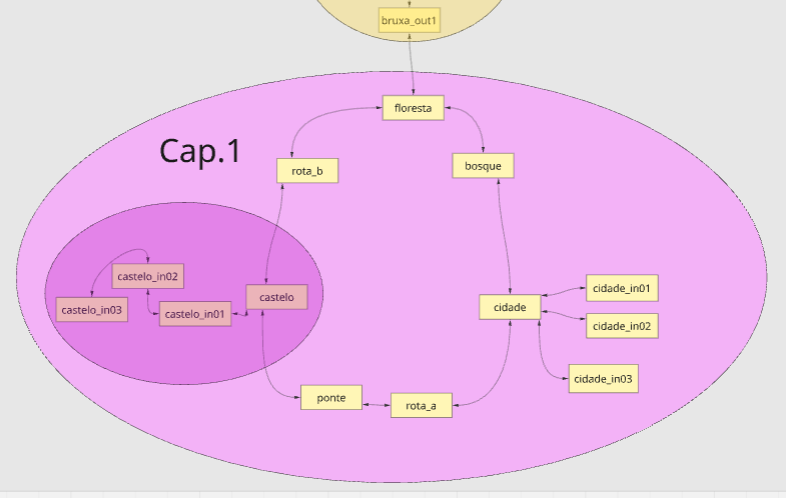
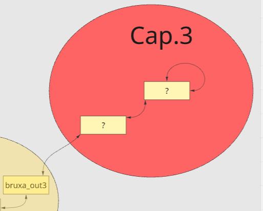

# Jogo da Bruxa






MAPA: https://miro.com/app/board/uXjVHHRQsyM=/

# Coisas a fazer

```
  ==============================
||		LEGENDA:	||
||	[ ] A fazer		||
||	[.] Em progresso	||
||	[?] Testar		||
||	[!] Finalizado		||
  ==============================
```

## Terminar até o Cap. 1 (1)

```

[ ] Arte Visual 100%
	[ ] Faces						(422x908 hoje; a parte de baixo fica escondida atrás da caixa de diálogo, então pode ser 420x740 ou outro tamanho, a foto é escalada pela altura mantendo a proporção)
		[ ] Bruxa
			[ ] neutro
			[ ] pensando
		[ ] Rei
			[ ] neutro
			[ ] furioso
		[ ] Princesa
			[ ] neutro
		[ ] Guarda1
		[ ] Guarda2
		[ ] NPC1 - Criança
			[ ] neutro
		[ ] NPC2 - Criança
			[ ] neutro
		[ ] NPC3 - Adulto
			[ ] neutro
		[ ] Goblin
			[ ] neutro
		[ ] Padre
			[ ] neutro

	[ ] Sprites			(tamanhos variados, abrir no assets) (a âncora do sprite é o centro-inferior)
		[ ] Bruxa
			[ ] parada				(80x252)
			[ ] andando
			[ ] correndo			(126x252)
		[ ] Rei						(105x200)
		[ ] Princesa				(105x200)
		[ ] Guarda1					(105x200)
			[ ] parado
			[ ] andando
		[ ] Guarda2					(105x200)
			[ ] parado
			[ ] andando
		[ ] NPC1 - Criança			(105x145)
			[ ] parado
			[ ] andando
		[ ] NPC2 - Criança			(105x145)
			[ ] parado
			[ ] andando
		[ ] NPC3 - Adulto			(105x200)
			[ ] parado
		[ ] Mercador pai			(105x200)
			[ ] parado
		[ ] Mercador filho			(105x200)
			[ ] parado
		[ ] Padre					(105x200)
			[ ] parado
		[ ] Portas
			[ ] porta padrão		(90x180)
			[ ] porta bruxa
			[ ] portão castelo
		[ ] Objetos
			[ ] Livro de Receitas	(69x69)
			[ ] ...

	[ ] Cenários			(largura variada, altura:640px)
		[ ] floresta				(6000x640)
		[ ] bruxa_in				(1280x640)
		[ ] bruxa_out1				(1280x640)
		[ ] bruxa_out2				(1280x640)
		[ ] bruxa_out3				(1280x640)
		[ ] bosque					(2000x640)
		[ ] cidade					(4000x640)
		[ ] cidade_in01				(1280x640)
		[ ] cidade_in02				(1280x640)
		[ ] cidade_in03				(2000x640) 
		[ ] estrada_a				(2000x640)
		[ ] ponte					(2000x640)
		[ ] castelo					(3000x640)
		[ ] castelo_in01			(2500x640) 
		[ ] castelo_in02			(1280x640)
		[ ] castelo_in03			(1280x640)
		[ ] estrada_b				(2000x640)

[ ]	Audio 100%
	[ ] BGM:
		[ ] intro 			(xxxHolic opening)
		[ ] floresta		(remix da que já tem)
		[ ] bruxa_out
			[ ] bruxa_out1	(só BGS de natureza)
			[ ] bruxa_out2	(só BGS de natureza) (variação)
			[ ] bruxa_out3	(só BGS de natureza) (variação2)
		[ ] bruxa_in 		(sem bgm, talvez bgs)
		[ ] bosque			(mágico, bem curto)
		[ ] cidade, _in01, _in02 (+ harpa, - volume, +palmas)
		[ ] cidade_in03
		[ ] estrada_a
		[ ] ponte
		[ ] castelo
		[ ] castelo_in01, castelo_in02
		[ ] castelo_in03
		[ ] estrada_b
	[ ] BGS:
		[ ] tremor
		[ ] passaros
		[ ] som floresta
		[ ] vento
		[ ] água correndo
		[ ] (metal?)
	[ ] SE:
		[ ] magia01		
		[ ] magia02 
		[ ] magia03
		[ ] pancada01
		[ ] pancada02
		[ ] corte
		[ ] vidro01
		[ ] vidro02
		
[ ]	Menus 100%
	[ ] Estilo de cartas
		[ ] definir carta para cada clicável.
	[.] menu inicial
		[ ] bg
		[ ] bgm
	[.] menu pause
		[ ] continuar, save, load, opções, menu principal
	[.] cena caldeirão
		[ ] bruxa, caldeirão, botões, inventário
	[ ] cena loja
		[ ] ... (depois)
	[.] opções (único)
		[ ] audio, 
		[ ] video, etc
	[ ] cartas/hud
		[ ] definir verso: pentagrama (giratório lento?), 
			principalmente as que fica no HUD sempre visivel 


[ ] Caldeirão 100%
	[ ]	Tutorial do caldeirão na 1ª vez. 
		mudar intro talvez. tentar integrar naturalmente com o que já tem.  
		(poção concentrada pó de retorno? 3; sem deixar errar). 
		Decidido: a bruxa fala e guia, livre (não trava botões). Mas pausa e te obriga a apertar o botão
	[?] Fogo frio: 3 cores de 400 a 800 (transparente 400, azul pálido 600, normal vermelho 800; no livro "Transparente grande" virou "Azul pálido"). Aceso fica opaco (alfa 0,8); só abaixo de 400 (apagando) vai sumindo até F = 0. (sistema_termico.gd CORES_FOGO)
	[?] Finalizar só aparece com itens no caldeirão, no canto superior direito.
	[ ] Layout
		[?] Fogo: apagado = um botão só, Acender (no lugar dos dois); aceso = −Fogo e +Fogo, independentes (o −Fogo não mexe mais no +Fogo; segurar o +Fogo não abafa). Saiu o botão Acender/Apagar de baixo.
		[ ] Reformular Layout (pensar em celular). 
		Menus, botões,Bruxa_chibi,caldeirão, tamanhos livre 
		texto em cima do caldeirão (passar para falas da bruxa), feedback rápido da bruxa.
	[ ] Feedback bom pra temperatura do caldeirão e itens, tanto frio quanto quente
		[.] TESTE de P e M:
			M = absoluto
			P = anel completo, provavelmente semáforo ou aproxima.
			C = o anel já é colorido, mas vai sendo revelado.
	[.] Teste de Mecânica: segurar para jogar itens
		Teste #1: 9/10 certos (itens a cada 0,4 s). Faltam mais 2 testes.
		Teste #2:  /10 certos 
		Teste #3:  /10 certos 
	[.] Resultado da Poção:
		[.] mostre o grafico certo, depois mostre o T(t) do jogador sendo feito.e os itens entrando. Não precisa mostrar mais os anéis de itens no resultado, mostre somente o gráfico já integrado com os itens (feito: curva ideal aparece, depois o T(t) é desenhado e cada item surge quando a curva passa; ícones pequenos sem anel, gráfico grande)
			EDIT: Mantenha os anéis, mas quero os itens se mantendo pequenos. (feito: anel volta, ícone pequeno; enche quando o item entra)
		
	[ ] Dúvida: Usar cartas tbm na cena do caldeirão, para botões, etc? testar como ficaria.
	[ ] Definir: Poção concentrada é só com precisão muito alta
	[?] Catálogo de poções (dados/pocoes): qualquer poção com a matriz perto de uma do catálogo recebe o nome dela e, se ela tiver, o efeito (com aproveitamento >= aproveitamento_min_efeito; evita 4 mal cozidos = 3 bem cozidos). Sem quantidades nem "Dobrada" (não serve para receitas não comutativas).
		[?] Pó de retorno ajustado para o tutorial: chama amarela (T 115–150 °C), ~25 s com os 3 pós (m 3300, s 2000/2200). Janela para 95%: ±5 s; para 90%: ±7 s. Receita do livro atualizada.
		Poção do Retorno (antes "Poção de Pó de Retorno Concentrada"; diálogos de bruxa_in e castelo_in03 atualizados): matriz de 3 pós, efeito com 95% → volta para casa.
		[?] Tolerância por poção (PocaoReferencia.distancia_max; 0 = a do catálogo, 0,05). Retorno: 0,02 → 2 ou 4 pós bem cozidos não viram mais Poção do Retorno nem ganham o efeito (simulador: experimento quantidade). Renomear a poção no livro não muda mais o efeito.
		[ ] PROBLEMA a tratar: quantidades diferentes podem chegar na mesma matriz (ex.: 4 mal cozidos ≈ 3 bem cozidos). Hoje só o aproveitamento mínimo segura.
	[?] Caldeirão: quando um item passa de 95% o ícone dá um pulo de brilho e toca um plim ("cura" se não houver plim.mp3). A guia já mostra os segundos que faltam no passo atual.
	[?] Água de Caldeirão com tolerância mínima (distancia_max 0,005).
	[?] Jogadas gravadas (só em build de debug): user://jogadas/<data>.json com histórico T/F, entradas, ações (+Fogo, −Fogo, acender, jogar), receita memorizada e aproveitamento. Usadas pela ferramenta de balanceamento.
	[?] Debug, aba Poções: histograma do aproveitamento de cada poção feita (user://estatisticas_pocoes.txt; só em build de debug), zerar, e botões para dar qualquer poção do catálogo pronta (★ = tem efeito).

[ ] Livro de Receitas:
	[ ] Cena do Livro:
		[?] Só as receitas existentes, sem páginas vazias. Nº ímpar: à direita da última, uma página transparente "+ Nova receita". Nº par: botão "+ Nova" no rodapé da direita na última folha. Tocar abre o editor (página ainda transparente); Pronto: o papel surge (animação) e a receita é transcrita; Cancelar: a página nem existe.
		[ ] Pensar em fazer um auto-cozinhar seguindo uma receita?... (pensar)
	[ ] Receitas:
		[ ] Balanceamento de Receitas:
			[ ] Criar mais receitas:
				Receita muito rápida, 
				receita muito demorada. 
				Receita muito quente. 
				Receita muito fria. 
			[ ] Pergunta: Dois pontos de cozimento diferentes para o mesmo item podem gerar poções diferentes?		
			[ ] Se eu colocar muita (QUANTO?) quantidade de um ingrediente, vai fazer uma poção muito forte.
			[ ] Faz sentido uma receita que leva o mesmo ingrediente 2x em tempos diferentes? I_tempo, I_Temper, Q, como conseguir aprovetar duas vezes um mesmo tipo de item numa mesma receita?
			[ ] DEPOIS: Fazer receita dobrada tem efeito de potencializar (escalar) a matriz resultante. por exemplo se fizer uma poção da calma profunda dobrada, 
			[ ] balancear dificuldade, peso de cada erro: tempo, temp, cozimento, explorar os TIPOS de matrizes. explorar o que é posível nesse sistema térmico
				[?] balancear o resultado da poção de extroversão. pois um cogumelo já está sendo suficiente para o melhor resultado, entender o pq.
				Por quê: o cogumelo multiplica E por 1,16 (+16%) e o critério do filho do mercador aceitava qualquer E que subisse 10% (e aceitava C/A/O mudando até "pouco").
				Ajuste: E precisa subir "muito" (>= +30%; a desenvoltura dá +40%) e O, C, A não podem mudar (menos de 10%); N não pode subir; nenhum traço extremo.
				Com 1 cogumelo agora: "B-bom... dia." / "Melhorou um pouco, mas ainda não dá para deixar a loja com ele."
			[.] Ver tipos de poções e dar nomes: 
				Database (nomes das proibidas ficam para o Cap. 2): Nomear as poções de referência no catálogo (PocaoReferencia: nome, descrição, A). Poção da Calma Profunda. Poção #2. Poções proíbidas. 
				Poção #2 = Poção da Desenvoltura (definir bem antes do Cap. 1; só usada no Cap. X).
				Poções proibidas: as que têm algum autovalor 0 (2^5 − 1 = 31 combinações de traços zerados). Ainda sem nome. (feito: 31 no catálogo como "Poção Proibida (sem O, C...)", nomes provisórios)
				Poção de Pó de Retorno Concentrada no catálogo, com efeito (teleporte para bruxa_in). Pó: diag(0.97,1,1,1,1.03), cozimento leniente (m 3000, T 60–170, t 10–150, folgas 0,4/0,6).
				Nome: poção de um item só agora usa "Poção de [item] [qualidade]" antes de procurar no catálogo (senão um pó mal cozido virava "Concentrada").

			
		[ ] 1ª receita: calma profunda
				
		[ ] 2ª receita: desenvoltura
			Ajustado: musgo t_max 12 → 35 (aguenta os ~30 s finais); flor m 2400 → 5000, s−/s+ 900/1400 → 1900/2900 (Q de 60 s a ~85 °C ≈ 5100). Juntos dão diag(1,1,1.4,1,1) se o musgo entra depois.
			balancear tempo, u,s-,s+, Tmin,Tmax,tmin,tmax, etc de cada item. infusao
			Está difícil saber a hora de colocar a flor. Mudar cor do fogo de forma mais clara? outras cores? 
		
[ ] História/Roteiro
	[ ]	Diálogos devem condizer com a época
		[ ] Cap. 1 (-N)
			[?] intro-Campones
			[ ] Guardas
			[ ] Bosque NPC
			[ ] Cidade 
			[ ] Castelo
		[ ] Cap. 2 (+E)
	[ ] Usar traços na história: 
		O,(conservador com pouca abertura)
		C (consequencialidade, prudencia, preguiçoso),
		A (amabilidade, aumentar ou diminuir?)
	[ ] Usar permutação de traços
	[ ] Poções proibidas


[ ] Diálogos 100%
	[ ] Intro : revisar texto (tempo e ritmo). ultimas frases da intro estão pequenas em comparação. a forma do texto é pirâmide invertida.
		[?] "Em 1484, o Papa..." agora é uma legenda sozinha (6 s) e "Toda mulher..." outra (6 s). O fundo rola mais devagar (28,8 px/s, antes 30) na mesma proporção do tempo a mais, para não chegar ao fim do sprite.
	[?] Cores nas falas (dialogue_box.gd, CORES_TAG): [ator]nome[/ator] azul claro, [item]erva[/item] roxo, [traco]Extroversão[/traco] verde, [ouro]10 moedas[/ouro] amarelo, [mapa]o castelo[/mapa] laranja. Só nas falas (caixa de diálogo); opções e legendas ainda não.
	[?] Fonte das falas: normal, negrito ([item]), itálico etc. todas com o mesmo tamanho (FONTE_PADRAO 28 ou o do estilo).
	[ ] Cap. 1: Revisão de cada evento.
	[ ] Sprites do  Balão de expressão: precisa da arte (1 sprite de balão, se der pra fazer sem deformar as quinas seria ideal) (talvez 9 blocos)
	[ ] Estilo visual:
		[ ] organizar o layout e textura dialogo/opções
		[ ]	Ajuste estético, borda, cor, fonte, etc.
		[ ]	Criação de estilos padronizados para cada coisa. estilo de texto, estilo de janela, paleta de cores, animação coerente, etc...
		[.] Eventos de diálogo devem verificar se o próximo evento a tomar a frente será diálogo também, exceto depois de comando wait, etc.
			Feito: a carta do diálogo não desvira se vem outro diálogo em seguida (Interpreter.dialogo_a_seguir: fila de diálogos ou próximo comando de um evento rodando, pulando os instantâneos como variável/if/label/item/som). 
			Esperar, mover, fade etc. interrompem. Espera no máximo 1,5 s (carta.gd: ESPERA_MAX_DIALOGO).
			se um evento acabar em mensagem e outro iniciar em mensagem com o mesmo falante, nome, foto etc então o card não deve fechar depois do primeiro evento, pois é uma continudade. 
			exemplos disso acontecem ao chamar eventos por comando, entre outros.
			Testar mais: no camponês, no castelo_in01.
			Feito também: quem chamou outro evento (Chamar evento) e volta com fala depois que o chamado termina em fala: a carta não fecha entre os dois.
			Rei: abrindo a carta 2x para o mesmo falante, "Tanta certeza assim?" "Pois aplique aqui na minha frente". Ver se é wait, ou o quê.
			Era o "ir para" (goto) + esperar 0,5 s entre as falas. Feito: a carta segue o goto e esperas curtas (até 1 s somado, ESPERA_CURTA_DIALOGO) não fecham a carta.
			[?] Testar: fala do rei e apagar esse tópico.


[ ] Quests
	[ ] Quest Zigmund
		[ ] personalidade
		[ ] situação
			[ ] problema
			[ ] objetivo
			[ ] plano
			[!] sumiu na floresta
			[!] pediu para a bruxa ajudar a princesa
			[!] casamento
	[ ] Quest Bosque Goblin
		[ ] ???
	[ ] Cap. 1 Casamento
		[ ] cidadeA_in01 não tem quest?


[ ] Personagens
	[ ] Fazer uma ficha de personagem 
	[ ] Criar personalidades big five
	[ ] Cada personagem tem seu linguajar próprio e manias.
		[ ] Bruxa
		[ ] Campones
		[ ] Guarda1
		[ ] Guarda2
		[ ] bosque_npc
		[ ] Cidade
			[ ] NPC Adulto
			[ ] NPC Criança 1 
			[ ] NPC Criança 2
			[ ] Casa 1
				[ ] NPC 
			[ ] Casa 2
				[ ] Mercador Pai
				[ ] Mercador Filho
			[ ] Igreja
				[ ] Padre


[ ] Eventos/Core:
	[?] Pular a intro com toques: escurece em 0,5 s (antes 1,5 s), sem a espera de 0,2 s, e o 2º toque (pular até a casa) já vale logo depois do 1º. A variável intro_historia é gravada antes, então pular direto não repete a intro. (intro_auto.tres)


[ ] Documentação e Organização
	[ ] organização da pasta Graphics(está sendo chamada de assets neste projeto) estilo rpgmaker:
		Animations (efeitos especiais, magias, etc)
		Characters (eventos)
		Icons
		Panoramas (imagens para cenário)
		Pictures (sprites para controlar na tela)
		Transitions
		Windowskins (janelas, etc)
	[ ] GDD
		[!] v1
		[!] v2
		[!] v3.3
	Referência (já feito, fica para consulta):
		Simulador do caldeirão (ferramentas/simulador_caldeirao.py, Python 3; gráficos com matplotlib): mesmas contas do jogo, lidas dos .gd/.tres. Experimentos: receitas, rodar, tempo, chama, mapa, monte (Monte Carlo), janelas, quantidade, otimizar, relatorio. Saída em ferramentas/sim_saida/. Ex.: python ferramentas/simulador_caldeirao.py tempo retorno
		Ferramenta de balanceamento (ferramentas/balanceamento.py; PySide6 + matplotlib; usa o simulador): abas Receita (editar passos, rodar, comparar com a anterior), Sensibilidade, Monte Carlo, Itens (mexer nos parâmetros ao vivo e salvar no .tres), Testes, Dificuldade (nota 1 a 5) e Jogadas reais (reavaliar e calibrar a jogadora simulada; grava ferramentas/calibracao.json). Linha de comando: --testes, --dificuldade, --calibrar [pasta].
		Editor de eventos em Python (_/editor_eventos, abrir com abrir_editor.bat; precisa de PySide6): páginas, condições, comandos, diálogo em texto (Ctrl+T), labels (F12), várias páginas/eventos de uma vez, buscar/substituir, desfazer, backup ao salvar. Ver _/editor_eventos/README.md.
		Parallax e câmera nas bordas: na borda a câmera para e todas as camadas param junto (fatores: fundo 0.2, meio 1.0, frente 1.1, interiores "Frente+" 0.9).
		Regra das imagens (para não aparecer cinza): camada sem loop precisa de largura ≥ 640 + fator × (largura do mapa − 640). Ex.: Frente 1.1 em mapa de 6000 px = 6536 px (ou scale x 1.09). Mapas maiores não são necessários.
		Por camada: bosque (Meio chão 1.0, Frente árvores 1.1, scale 1.07); bruxa_out (Fundo 0.2, casa no Meio); castelo_in03 (Fundo 0.2, Frente 1.1, scale 1.051); castelo_out (Fundo 0.2, Frente 1.1); cidadeA, estradaA, estradaB (Fundo 0.2); ponte (Fundo4 céu, Fundo3 nuvens longe pan -6, Fundo2 montanha, Fundo nuvens pan -12, todos 0.2; Meio/Meio2/Meio3 1.0; Frente nuvens 1.1 pan -40).


[ ] Decisões menores:
	[ ] (fazer depois) Personalidade do alvo na hora de aplicar a poção.
	[ ] (fazer depois) A ação da poção deve mostrar a personalidade mudando.
	[ ] (fazer depois) Logo: diminuir o caldeirão e deixar mono tom, sem efeitos.
	[?] Livro: virar página mais rápido (0,2 s); na última folha o "›" vira "+ Nova"; arrastar para avançar na última folha fecha o livro; ao fechar, as páginas fecham na lombada e depois o livro some; passar a limpo não abre mais o editor.
	[?] Caldeirão: o +Fogo não fica mais avermelhado (nem ao acender, nem ao soltar).
	[?] Resultado: poção com efeito toca um "plim" antes do nome aparecer (res://audio/se/plim.mp3; sem ele, magic.mp3).
	[?] Usar poção com efeito para a bruxa (ela não segue andando).
	[?] Debug simplificado: 4 abas (Jogo = variáveis + personalidade + estados salvos; Itens = itens + poções; Mapa; Comandos), fonte e botões maiores. Abre na hora e monta a aba no frame seguinte (uma parte por frame).
	[?] Intro: pular com toque faz a legenda sumir com fade curto (0,3 s), sem corte seco, junto com o fade do comando.
	[.] Guardas da ponte e da estradaB: o Mover da bruxa vinha antes da variável que libera, e a página sólida bloqueava. Agora a variável vem antes: a página muda na hora (passável) e o Mover anda. Regra: a página do evento troca assim que a variável muda, mesmo com os comandos ainda rodando. (mudar para 250px de deslocamento)
	[?] brilho na porta, da mesma cor do véu, ao trocar o véu.
		Feito: ao clicar no véu adicione um flash da cor do véu no sprite da porta, para que ele pisque da cor.
		Feito: saiu o brilho da porta (o do véu continua); a porta pisca 2 vezes na cor nova. Novo tipo de efeito PISCAR no Mostrar efeito (serve para qualquer evento)
		Correção: tingiu, mas como a cor do objeto não era branca misturou as cores do objeto mais a tintura. quero que leve em consideração isso e pinte da cor que eu pedi. preciso mandar o mesmo sprite com tons de branco para isso?
		Feito: não precisa de sprite branco. No pico do piscar cada pixel vira a cor pedida (com só um leve claro/escuro para manter o desenho) e a tintura própria do sprite (self_modulate) é desligada durante o piscar.
	[ ]	Representação de poções visual com matriz/grafo. (feito, versão simples: no pentágono cada ponta sai do traço que mais contribui e gira até a sua; diagonal = só escala com um pulo)
	[ ]		(Cap. 2) Mostrar o pentagrama, cada aresta representa um componente. Pensei em relacionar as arestas com a_ij e criar um feedback útil visualmente.
	[ ]		(Cap. 2) O pentagrama deve ter animações a depender da matriz. Por exemplo, matriz diagonal (ou próxima de diagonal a menos de ruído) só escala, então a animação do pentagram é escalar. Matriz que troca dois componentes deve trocar duas pontas do pentagrama suavemente, como uma permutação ou rotação.

[ ] Bugs/Revisão:
	[ ] missao01_convite é gravada e nunca lida: fica para o Cap. 2 (convite do casamento).


```

## Possíveis expansões (futuras)

```
[ ] Sistema de clima
[ ]	Sistema de fama
[ ]	Sistema de compra/venda
[ ]	Sistema de mercado/valor dinâmico

```
